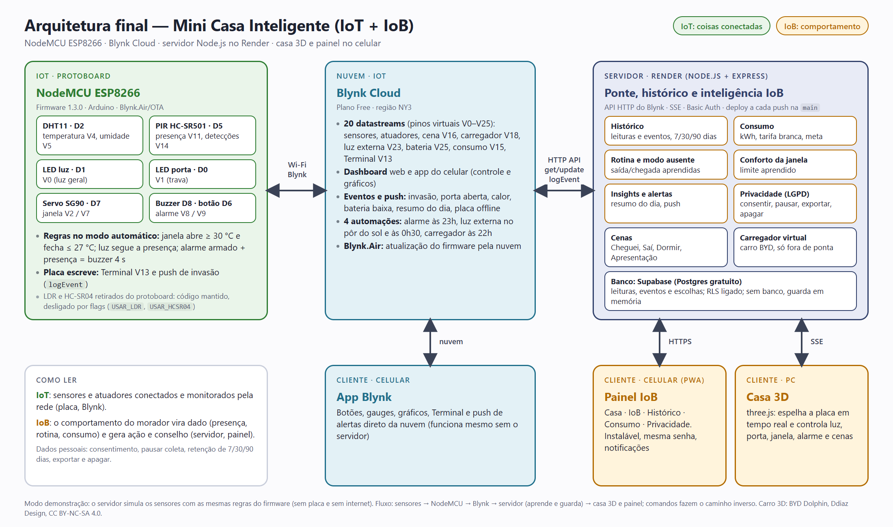

# Mini Casa Inteligente — IoT + IoB

Projeto final de **Internet das Coisas e do Comportamento** (FEPI · Sistemas de Informação · Prof. Evaldo Renó).
Um NodeMCU ESP8266 com sensores e atuadores, controlado pelo Blynk, espelhado em tempo real por um gêmeo digital 3D
e acompanhado por um painel no celular que **aprende a rotina da casa** (a parte IoB).



```
Protoboard ── NodeMCU ESP8266 ── Wi-Fi ──► Blynk Cloud ◄── API HTTP ── servidor Node.js (Render) ── SSE ──► casa 3D e painel do celular
                                                 │                              └── Supabase (histórico)
                                                 └── app e dashboard do Blynk, eventos, push e automações
```

## IoT × IoB: onde está cada parte

| | O que é | Onde está |
|---|---|---|
| **IoT** | Sensores (DHT11, PIR) e atuadores (LEDs de luz e porta, servo da janela, buzzer, botão) conectados e controlados pela rede | `firmware/` (NodeMCU), Blynk Cloud, dashboard e app do Blynk |
| **IoB** | O comportamento do morador vira dado e gera ação e conselho: histórico, consumo e economia, rotina aprendida, modo ausente, conforto adaptativo da janela, insights, alertas, cenas e carregador do carro elétrico | `app-3d/server/*.js`, painel do celular (`/painel`), casa 3D |
| **Ética** | Consentimento no primeiro acesso, pausar a coleta, retenção de 7/30/90 dias, exportar e apagar os dados (LGPD) | tela Privacidade do painel; texto em [`app-3d/README.md`](app-3d/README.md) |

## Pastas

```
app-3d/      Casa 3D + servidor ponte com o Blynk + painel do celular (Node.js, three.js)
firmware/    Firmware do NodeMCU ESP8266 (credenciais em secrets.h, fora do git)
scripts/     Tarefas do VS Code: instalar, compilar, gravar USB, gravar Wi-Fi, gerar .bin
wokwi/       diagram.json e libraries.txt do simulador (versão ESP32-S3, referência)
docs/        Hospedagem, Blynk (datastreams, dashboard, eventos), capturas de tela, documentos do projeto
render.yaml  Blueprint do Render (deploy automático a cada push na main)
```

## Hardware

| Peça | Pino | Pino virtual no Blynk |
|---|---|---|
| LED luz | D1 | V0 |
| LED trava da porta | D0 | V1 |
| Servo SG90 (janelas) | D7 | V2 comando · V7 status |
| DHT11 | D2 | V4 temperatura · V5 umidade |
| PIR HC-SR501 | D5 | V11 presença · V14 detecções do dia |
| Buzzer | D8 | V8 status do alarme |
| Botão arma/desarma | D6 | V9 |

O **LDR** e o **HC-SR04** foram retirados do protoboard: ficaram instáveis e atrapalhavam a presença do PIR.
O código foi mantido e é desligado por flags (`USAR_LDR`, `USAR_HCSR04` no firmware; `SENSORES=` no servidor),
então religar é só trocar as flags. Sem o HC-SR04, o carro virou o **carregador virtual** do carro elétrico (BYD
Dolphin em 3D, CC BY-NC-SA 4.0, Ddiaz Design), que entra no consumo de energia.

Regras do firmware no modo automático: janela abre ≥ 30 °C e fecha ≤ 27 °C; a luz segue a presença; alarme armado +
presença dispara o buzzer por 4 s. Firmware atual: **1.3.0** (Terminal V13 e push de invasão pela placa).

## Primeira vez em um PC

1. Abra a pasta no VS Code.
2. `Ctrl+Shift+P` → *Tasks: Run Task* → **ESP8266: instalar ferramentas**.
3. Preencha `firmware/casa_inteligente/secrets.h` (token do Blynk, Wi-Fi, senha do OTA).
4. **ESP8266: compilar** e, com a placa no USB, `Ctrl+Shift+B` (**ESP8266: gravar pela USB**).

Detalhes, pinagem e atualização pelo Wi-Fi: [`firmware/README.md`](firmware/README.md).

## Casa 3D e servidor

Tarefa **Casa 3D: iniciar**, ou:

```bash
cd app-3d
npm install
npm start          # http://localhost:3000   (painel do celular em /painel)
npm test           # 48 testes do servidor
```

Sem `app-3d/.env` abre em **modo demonstração** (sensores simulados com as mesmas regras do firmware, sem placa e
sem internet) — é também o plano B da apresentação. Para espelhar a placa, copie `app-3d/.env.example` para
`app-3d/.env` e preencha `BLYNK_TOKEN` e `BLYNK_SERVER`. Referência completa (variáveis, API, painel, privacidade,
carro, cenas): [`app-3d/README.md`](app-3d/README.md).

## Blynk

Datastreams (V0–V25), dashboard web e do app, eventos com push (invasão, porta aberta, calor, bateria baixa, resumo do
dia), automações e Terminal: passo a passo em [`docs/BLYNK.md`](docs/BLYNK.md).

## Publicado no Render

O servidor também roda no Render (plano Free), configurado pelo `render.yaml`, com senha obrigatória e deploy
automático a cada push na `main`. O histórico fica no Supabase (Postgres gratuito). Passo a passo, variáveis e
cuidados (inclusive o monitor para o serviço não dormir): [`docs/HOSPEDAGEM.md`](docs/HOSPEDAGEM.md).

## Créditos

- Modelos 3D do carro: *2024 BYD Seal* e *2024 BYD Dolphin*, de **Ddiaz Design** (Sketchfab), licença
  [CC BY-NC-SA 4.0](https://creativecommons.org/licenses/by-nc-sa/4.0/); cópias com geometria comprimida (meshopt),
  mesma licença. Uso não comercial, com atribuição (o crédito aparece no canto da casa 3D).
- three.js, Express, uPlot e as fontes DM Sans, Unbounded e JetBrains Mono (servidas localmente).
